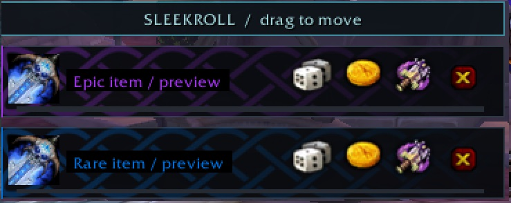
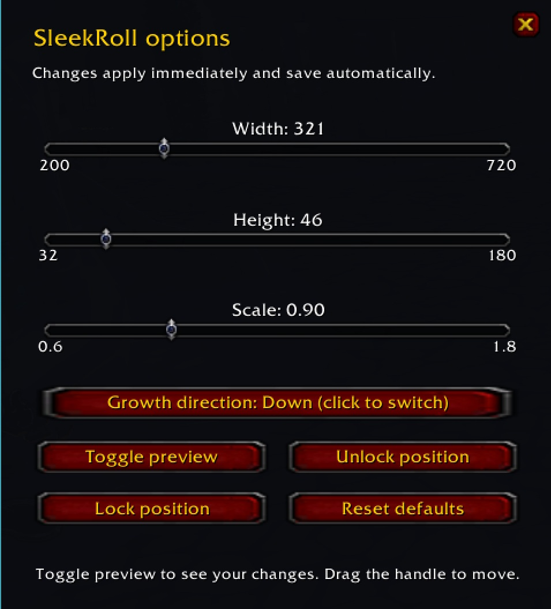

# SleekRoll 1.0

A minimal, movable group-loot roll interface for **World of Warcraft 3.3.5a (Wrath of the Lich King)**. Interface version: `30300`.

## Download

### [⬇ Download SleekRoll 1.0 for WoW 3.3.5a](https://github.com/baker42792-sketch/SleekRoll/releases/download/v1.0.0/SleekRoll-1.0.0.zip)

**Use the link above to install the addon.** It contains only the addon files and Media folder, inside a correctly named **SleekRoll** folder. No renaming is needed.

> **Do not use Code → Download ZIP to install.** That is GitHub's source archive: it creates **SleekRoll-main** and includes README files. GitHub controls that folder name. Likewise, the automatic **Source code** links on the release page are not the install package.

On the [release page](https://github.com/baker42792-sketch/SleekRoll/releases/tag/v1.0.0), choose the **SleekRoll-1.0.0.zip** asset.

## Preview

### Loot roll windows

Rarity-colored knotwork, original WoW roll icons, and a movable compact layout.

### Options window

Adjust width, height, scale, growth direction, and position with `/sr`.

## Features

- Adjustable width (200–720), height (32–180), and scale (0.6–1.8).
- Compact single-line layout for thinner windows.
- Upward or downward stacking, with saved position and settings.
- Original WoW dice, coin, disenchant, and pass icons.
- Rarity-colored knotwork fading from 33% opacity on the left to transparent on the right.
- Black backing sized to each item name for readability.
- Options window and a safe preview mode.

## Installation

1. Close WoW.
2. Extract the release ZIP and copy its **SleekRoll** folder into `World of Warcraft/Interface/AddOns/`.
3. Confirm the final path is `Interface/AddOns/SleekRoll/SleekRoll.toc`.
4. Enable **SleekRoll** in the character-selection AddOns menu.
5. Enter `/sr` in-game to open the options window.

GitHub's **Code → Download ZIP** and automatic **Source code** archives use a version or branch suffix. If you use one of those archives, rename **SleekRoll-main** (or **SleekRoll-1.0.0**) to **SleekRoll** before installing. Include its **Media** folder. The ready-to-install download above requires no renaming.

## Configuration

Use `/sr` to adjust width, height, scale, and growth direction. Use **Toggle preview** to see changes, **Unlock position** to show the drag handle, and **Lock position** when finished. Changes save automatically.

Optional shortcuts:

| Command | Action |
| --- | --- |
| `/sr test` | Toggle preview rows |
| `/sr unlock` | Show the drag handle |
| `/sr lock` | Hide the handle and preview |
| `/sr size 240 40` | Set width and height |
| `/sr scale 1.2` | Set overall scale |
| `/sr growth up` | Stack upward |
| `/sr growth down` | Stack downward |
| `/sr reset` | Restore all defaults |

`/sleekroll` also works.

## Compatibility

Designed for the original 3.3.5a client, not modern WoW Classic or Retail. Disable other addons that replace or skin group-loot frames. Blizzard's original frames handle roll eligibility, item tooltips, confirmation prompts, and cancellation. The original four simultaneous group-loot frames remain the limit.

At narrow widths, long item names may be truncated; hover the item icon for its tooltip.

## Reporting problems

Include your client build, other loot-related addons, the settings used, and a screenshot or error text. Enable Lua errors with `/console scriptErrors 1` if necessary.
